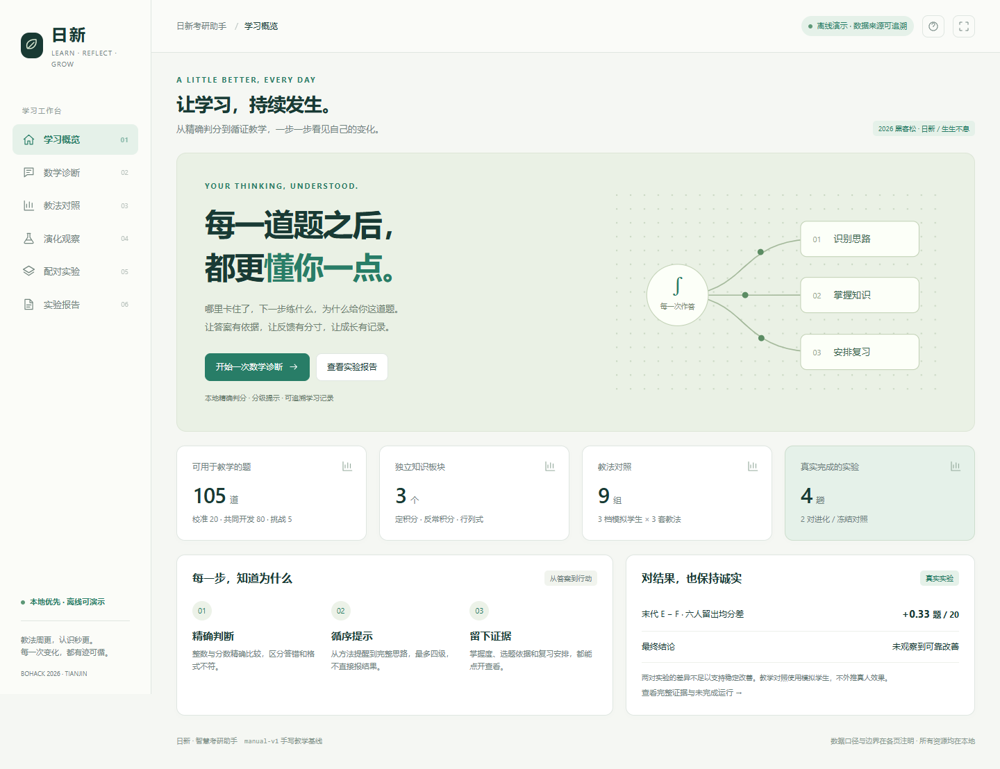

> **当前成品入口（2026-11-14）**
>
> [下载完整离线演示包](https://github.com/Coder-YourAdm/AI-Gu-Farm/raw/refs/heads/main/releases/demo_offline.zip) · [前端优化与验证](docs/demo/前端优化与验证.md)
>
> 六页源码在 `web/`。双击解压包内 `START_DEMO.bat` 可启动；直接打开 HTML 可浏览离线证据，实时练习需要 Python 3.11+ 本地服务。
>
> 已合并远端的“查看答案 / 一键演示 / 记忆定位”，并保留辅助作答口径。新增真实运行切换、配对检查点、筛选排序、权重试算、导出和报告打印。61 项真实 Chrome 检查通过。
>
> **结果口径**：末代六人留出均分 E−F 约 +0.33 题/20，未观察到可靠改善；个体留出最高分单列，不能称作适应度冠军。模拟学生、固定回放和真实模型数据明确区分，取消/未启动运行保留。
>
> 启动：`python app/serve.py --port 8124 --allow-tutor`，进入 `http://127.0.0.1:8124/cover.html`。
> 重建成品：`python tools/build_offline_package.py`。
> 前端检查：`npm install`、`npx playwright install chromium`、`npm run test:frontend`（设置 `PYTHON` / `CHROME_PATH` 可指定本机程序）。旧内联页面自检脚本为历史工具，新版以前述真实浏览器检查为准。



---

# AI 养蛊机 · Prompt Evolver → 日新 · 智慧考研助教

> **BoHack 2026 天津青年黑客松** · 赛道主题「日新 / 生生不息」
> **霹雳无敌南开吊炸天队** ｜ 洪修睿（A）· 毛尚胜（B）· 徐潇（C）

**我们不让模型给自己打分。**

前半程，6 个 prompt 个体互相出题、互相解题，按区分度淘汰重组，
20 代后测量模型在这个题域上的能力上限；判分全程走本地 `Fraction` 精确算术，
**不用 LLM 当裁判、不经过一个浮点**。后半程，把练出来的教法冻结成一份文件，
配上掌握度估计、五级提示和带证据的记忆，交给一个 AI 去服务真实学生：
学生答一道题，它当场判、当场讲、当场改变对你的认识，并且能点开说清
**「为什么给你这道题」**。

> **教法周更，认识秒更。** —— 这就是我们对「日新」的回答。

---

## 硬核数字

| | |
|---|---|
| **612** | 条测试全绿（0 failures / 0 errors / 8 skipped） |
| **1200** | 个 SymPy 随机样本，四族公式零分歧（开发期交叉验证，不进判分链路） |
| **125** | 道自造题，签名全部互斥；8 条题面与规格附录 A 逐字对齐 |
| **4 × 20** | 趟真模型演化（E/F 两对）+ **2640** 次留出评测调用 |
| **12.8 → 52.8 → 92.8%** | 三档校准：难度是唯一杠杆，360 条回答零格式错误 |
| **9** | 行教法对照，`loose` 胜出；**0** 个 p 值（样本不够就不装显著） |
| **0** | 外链、**0** 个 `reference` 泄漏、**0** 次「靠模型判断对错」 |

---

## 项目到底在干什么

```
[训练期 · 重 · 离线]                [产物]              [运行期 · 轻 · 每句话]
6 个体 / 20 代 / 精确判分     →   best_profile.json   →   judge / BKT / 五级提示
app/run.py + executor.py           冻结、带 evidence        app/student + app/tutor
                                                              ↓
                                                web/{cover,tutor,compare}.html
                                                回放断网可演 · 实时真接口
```

| | 阶段一 · 练功（已完成） | 阶段二 · 服务（可演示，部分施工中） |
|---|---|---|
| 谁在变 | 6 个 prompt 个体 × 20 代 | 掌握度、题目难度、记忆强度、复习排期 |
| fitness | 出题区分度 + 解题正确率 | **学生增益 − 0.25 × 交互成本** |
| 产物 | 冠军个体 / 冻结协议 | `best_profile.json`（可 diff、可回滚） |
| 依赖 | 模型（出题 / 解题） | **本地引擎**，模型只负责把下一步说成人话 |
| 断电能否演示 | 不能 | **能** |

**三层「日新」**：群体层 20 代更替（离线训练）→ 教法层 profile 周更（离线重训）
→ 认识层掌握度每答一题都变（秒级）。演化放到训练期，运行期只留一个 AI——
因为一趟演化要 2289 次调用，放线上是灾难；冷冻的 prompt 是文件，能 diff、能回滚，
评委当场看到的不会正好是最差的一代。

**运行期只读 profile，不读 `runs/`、不读 `history.jsonl`、不读 `config.json`。**
这一条同时买到三件事：学生端不可能泄漏参考值、换模型不影响产品、旧版本存档即回滚。

---

## 技术护城河

1. **三态判定**：`right / wrong / unanswered`。把「拒答」混进「算错」，学到的规则方向就是错的。
2. **白名单下发**：模型只拿 `type / statement / answer_format` 三个键；`reference`、模板编号、
   历史成绩一个都不给。禁止 `json.dumps(task)` 直接发。
3. **入口先拒绝**：正则 → 位数 ≤64 → 指数 ≤30，全部做完才调 `int` / `Decimal`；
   9000 字符响应在 `json.loads` 之前就拒，挡住 `Fraction("1e999999")` 这类构造。
4. **升级必须挣来**：学生说「我懂了」不算，必须无提示、独立、换一道同知识点不同参数的题再对一次。
5. **fitness 减成本项**：只加增益，演化一定选出「无限提示、把答案嚼碎」的策略；
   减掉交互成本，才选得出「话少而准」。
6. **单变量实验**：3 套教法 × 3 档模拟学生，题目 / 判分 / 随机流完全相同，
   每题独立派生随机流——否则提示消耗随机数会让后面题目的抽签错开，测出来的不是教法。
7. **断网可演**：前端单文件内联、零外链；回放读静态 JSON，实时走本地接口。
   演示不押注网络、端口或模型心情。

> 完整论证见 [项目总纲](docs/00_项目总纲.md) §2。

---

## 三人分工

> 一句话总览：**A 把判分变成物理定律，B 让演化跑在真实算力上，C 让评委亲手点开真相。**

| | **洪修睿 · A** | **毛尚胜 · B** | **徐潇 · C** |
|---|---|---|---|
| 主责 | 判分内核 / 学生模型 / 对照实验 / 方案与验收 | 演化引擎 / 正式实验 / 助教后端 / 记忆与提示 | 三页前端 / 演示素材 / 自检脚本 |
| 独占目录 | `app/executor.py`、`scoring.py`、`ancestor.py`、`app/student/`、`app/evalsim/`、`tools/` | `app/run.py`、`runner.py`、`runtime.py`、`store.py`、`llm_async.py`、`app/tutor/{dialog,hint}.py`、`app/serve.py` | `web/`、`docs/demo/`、`docs/demo/shots/` |
| 硬指标 | 判分 0 浮点、612 条测试、9 行对照逐行自洽 | 4 趟 × 20 代真数据、协议冻结、接口探针 PASS | 三页零外链、断网可演、7 张截图 |
| 产出契约 | `history/A_to_B_接口契约.md`、`history/A_executor_实现说明.md` | `docs/demo/给B_B7最小集.md` | `docs/demo/自检_逐项对照_C0-C13.md` |

### A · 洪修睿 —— 把判分变成物理定律

**阶段一**：`executor.py` 六个函数（校验 / 归一 / 闭式解 / 白名单视图 / 签名 / 三态判分）、
三个答案解析器、四族精确模板（多项式积分 · Γ 型反常积分 · 高斯奇次矩 · Bareiss 行列式）、
`statement()` 题面生成；`scoring.py` 计分降噪与同分打散；`ancestor.py` 分型失败率与断点均线。
把六个函数写成两份文档，让 B 的编码 AI 不用回来问一句。

**阶段二**：`app/student/` 五个模块——KC 映射、BKT（手算对照 `0.5526 / 0.1774 / 0.8440`）、
Elo-lite 难度（修掉 400 刻度与 `[0,1]` 归一化的矛盾）、SM-2 复习排期、六条错因判据与 `why()`；
`app/evalsim/` 三档模拟学生 + fitness；`tools/tutor_cli.py` 产出 8 轮回放、
`tools/compare.py` 产出 9 行对照；评测报告、校准结论、方案与分工文档。
**仍负责**：集成点 2 真人验收、答辩 7 问、实时层验收、彩排与冻结。

### B · 毛尚胜 —— 让演化跑在真实算力上

引擎全套（异步 HTTP、角色温度、限流重试、硬预算、不可覆盖快照、断点恢复、
协议预登记、组间评测）；真模型 **4 趟 × 20 代 E/F** + 留出 2,640 次调用，
交付简报 / 运行清单 / 协议偏离说明 / 三张图数据 / 断点恢复实测。
自查修掉 15 个问题（检查点读下一代、g0 被覆盖、预算只是配置字段等）。

20:00 前落地 **B7 实时接口**：`POST /api/ask` + `--allow-tutor`、
`dialog.py` 六动作状态机、`hint.py` 五级梯度；契约探针 11 次 PASS
（连错 `[1,2,3,4,4]` 封顶、`reset` 回首题）。
记忆检索 / 画像 / `skills/` 打包仍在施工，**不阻塞主线**。

### C · 徐潇 —— 让评委亲手点开真相

六个单文件页面（`cover / tutor / compare / index / evolve / result`），零外链、断网可开。
`tutor.html` 六区域：对话流、3 条掌握度横条、**「为什么给我这道题」折叠面板**、
记忆时间轴、复习计划、profile 版本号；内置本地假 Tutor 与双模式开关（请求失败自动切回放）。
`compare.html` 9 行明细 + 页脚逐行口径自检（差 >0.002 标红）。
`docs/demo/` 11 份自检脚本、`shots/` 7 张截图、答辩 3 问、自包含分享包。
**还反过来查出两处契约错误**（`7/6 → 1`、`cost 0.280 → 0.790`），A 已订正。

> 每步「做什么 / 产出 / 验收命令 / 卡住怎么办」见 [12 小时详细分工](docs/分工_12小时_详细版.md)。

---

## 现在能跑什么

| 能力 | 状态 |
|---|---|
| 判分内核 `app/executor.py` | ✅ 六函数齐全，48+ 条单测，三态判定 |
| 题集 125 道 + 数据与页面自检 | ✅ `validate_task` 125/125；`check_web_contract.py --require-compare` PASS |
| 演化引擎 `app/run.py` | ✅ 真模型 4 趟 × 20 代，协议冻结 |
| 留出评测 | ✅ 2,640 次调用已跑；`web/result.json` 已接真实数据，主指标见 `web/experiment.json` |
| 学生模型 / 五级提示 / 对话状态机 | ✅ BKT / KC / 难度 / 排期 / 诊断 / hint / dialog 全合入 |
| **`POST /api/ask` 实时接口** | ✅ 已实现并接入 `LIVE.endpoint="/api/ask"`；`probe_ask.py` 11 次 PASS |
| 三页前端 + 7 张截图 | ✅ 零外链、断网可演、双模式回退 |
| 三套教法对照 | ✅ 9 行，`fitness = 增益 − 0.25 × 成本`，`loose` 胜出 |
| 全量回归 | ✅ **612 tests / 0 failures** |
| 完整记忆 / `skills/` / 离线包 / 90 秒录屏 | 🚧 施工中，不阻塞主演示 |

**实验结论（诚实版）**：E−F 两对 `+0.50 / +0.17`，均值 **+0.33 题/20**，
**未观察到可靠的策略改善**（方向为正、幅度在噪声内）。稳定可复现的发现是挑战题越界
（5 阶行列式连续六代 0/6）。见 [B 交付简报](docs/B_交付简报.md)。

---

## 5 分钟跑起来

```bash
# 1. 依赖与全量回归
python -m pip install -r requirements.txt
python -m pytest -q                       # 612 passed

# 2. 静态服务 + 实时助教（三页互跳，评委可亲手答题）
python app/serve.py --port 8123 --allow-tutor
#   → http://127.0.0.1:8123/cover.html   封面
#   → http://127.0.0.1:8123/tutor.html   诊断 / 实时 / 理由面板
#   → http://127.0.0.1:8123/compare.html 3×3 教法对照
#   注意：用 http://，别用 file:// 双击（浏览器会拦本地 fetch）
#   正式演示按 docs/demo/演示操作单_C11_C12.md 用 --port 8124 --allow-tutor
#   （8123 常被旧预览进程占用）；两个端口都能跑，别同时起两个服务

# 3. 数据与契约自检（离线、幂等）
python tools/tutor_cli.py --sid demo --turns 8 --out web/tutor.json
python tools/compare.py --seed 42 --out web/compare.json
python tools/check_web_contract.py --require-compare
python docs/demo/probe_ask.py --url http://127.0.0.1:8123/api/ask

# 4. 真模型（密钥只落本地 .env，永不入库）
python tools/set_model.py --list
python tools/set_model.py --provider deepseek --model deepseek-chat --key sk-xxxx
python tools/preflight.py --config config.local.json --require-key --probe
python -m app.run --config config.local.json --dry-run --all-seeds
```

`preflight` 逐项检查配置语义、`require_runtime_ready`、密钥、125 题自校验、
判分往返、目录可写、调用量是否装得下 `max_calls`——**任何一项 FAIL 都不要开跑**。
`--probe` 会显示服务端回显的 model；当前链路走中转，传 `deepseek-chat`
恒回显 `deepseek-flash`，报告里必须如实写这一句。

---

## 判分为什么值得看

题域限定在两类可精确求解的题：多项式 / 指数积分、整数矩阵行列式。
答案一律用 `Fraction` 计算——`0.1 + 0.2 != 0.3` 这种事不会污染分数。

| `judge()` 返回 | 含义 |
|---|---|
| `right` | 答案正确 |
| `wrong` | 格式合法但数值错误 |
| `unanswered` | 拒答 / 空响应 / 格式错 / 超长 / 非数值 |

**拒答与算错必须分开。** 混成一个 `False`，会让「模型拒答」看起来像「模型算错」，
于是针对错误类型学到的规则全是错的方向。助教侧复用同一条链路：
学生端只拿三个字段，`reference` 永不外发；掌握度与提示全由本地引擎算，
模型只负责把下一步说成人话。

---

## 文档导航

> 仓库里 64 份 `.md` **一份没删**，按下面五层找就不会迷路。
> **完整地图见 [项目总纲](docs/00_项目总纲.md) §9。**

| 层 | 看什么 | 入口 |
|---|---|---|
| ① **权威**（开工只看这些） | 方案 + 分工 + 状态合并入口 | [**docs/00_项目总纲.md**](docs/00_项目总纲.md) |
| | 助教完整设计（8 KC / 五级提示 / 答辩 12 问 / 11 个开源参考） | [docs/完整方案_日新考研助手.md](docs/完整方案_日新考研助手.md) |
| | 给编码 AI 的冻结契约与角色 prompt | [docs/AI可读_实施方案.md](docs/AI可读_实施方案.md) |
| | 每人每步的验收命令 | [docs/分工_12小时_详细版.md](docs/分工_12小时_详细版.md) |
| | 原始规格与附录 A 用例 | [方案/技术规格_v5.md](方案/技术规格_v5.md) |
| ② 契约 | 六函数 JSON 形状 / 内部逻辑 / B7 最小集 | [history/A_to_B_接口契约.md](history/A_to_B_接口契约.md) · [history/A_executor_实现说明.md](history/A_executor_实现说明.md) · [docs/demo/给B_B7最小集.md](docs/demo/给B_B7最小集.md) |
| ③ 证据 | 正式实验 / 对照 / 校准 / 评测 | [B_交付简报](docs/B_交付简报.md) · [评测报告](docs/评测报告_12h.md) · [校准结论](docs/校准结论_12h.md) |
| ④ 过程台账 | 时点体检、待办、通知、交接存档 | [history/仓库体检_20h.md](history/仓库体检_20h.md) · [history/待办_BC_15h.md](history/待办_BC_15h.md) · [history/队友通知_待发消息.md](history/队友通知_待发消息.md) |
| ⑤ 历史草稿 | 初稿、原分工、v1–v4 大纲（已被总纲合并，保留追溯） | `history/后续方案_智慧考研助手.md` · `history/分工_12小时.md` · `history/分工方案_v7.3.md` · `方案/历史版本/**` |

**判读原则**：只有 ① 层能作为开工依据；②③ 用于查证；④⑤ 是决策留痕。

---

## 已知边界

- **只做答案能精确复核的题型**（当前 3 个知识点：定积分 / 反常积分 / 行列式）。
  证明题、英语作文、政治大题明确拒答——**这是判分可信的前提，不是能力缺陷**。
- 真模型校准随难度分档：原卷 12.8% ／ 行列式降到 2–3 阶后 **52.8%** ／ 全简单 92.8%；
  零格式错误 ⇒ 是题难度而非解析问题，见 [校准结论](docs/校准结论_12h.md)。
- 正式演化 **未观察到可靠策略改善**；教法 profile 仍是手写基线 `manual-v1`。
- `web/result.json` 为真实个体补充数据，六人均分主指标另见 `web/experiment.json`。
- 3×3 对照是**模拟学生**、n=3 档 × 10 题，**不报 p 值**、不外推真人。
- 服务端回显模型与传入 ID 不一致（中转）；严格可复现需换官方直连。
- 提示级别**实现层已统一**（20:26）：0=无提示、1..4 四档封顶、第 4 级给完整解法但不报最终数值；
  前端判分改用 BigInt，超过 2^53 的答案不再失精。仅冻结契约 §6.5 的旧 LADDER 文案待同步
  （改契约需三人同意），答辩按新口径讲，见 [20:10 体检](history/仓库体检_20h.md) §4。
- 附录 A 的 D2 矩阵元素 `10` 超出 §2.1 的 `[-9,9]`：测试已换成等值矩阵并补
  `validate_task` 断言，规格原文未改，见 `history/给A_边界冲突说明.md`。
